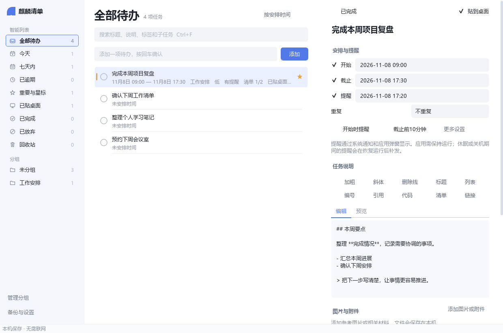
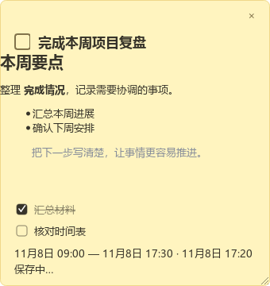

# 麒麟清单（KylinList）

[](https://github.com/hualiyexi/kylinnote/actions/workflows/build.yml)

面向离线办公环境的个人任务与清单软件。统一管理任务、子任务、时间与多提醒，支持将需要关注的任务贴到桌面。桌面便签只是任务的展示方式，不是独立的数据对象。采用原生 Qt Widgets，不依赖浏览器、账号或云服务。

主要目标是 **银河麒麟 V10 SP1 / 飞腾 FT-2000 / ARM64**，Windows x64 用于开发预览。Linux 固定在 **Ubuntu 20.04** 中构建，两端均使用 **Qt 5.12.8**。更名前的系统 Qt 小包已在麒麟 SP1 2503 x86_64 虚拟机实测可用；当前 KylinList 新库版本及飞腾 ARM64 真机仍待用户试用。已确认的环境与日常做法见[兼容性基线](docs/kylin-development-workflow.md)。

## 可以做什么

- **任务面板**：快速记录任务，搜索标题、说明、标签和子任务，按安排时间、优先级、创建时间或标题排序。
- **智能视图**：全部待办、今天、七天内、已逾期、重要与星标、已贴桌面、已完成、回收站。
- **清单组织**：当前界面提供平级清单、四档优先级、星标、标签和可逐项完成的检查清单；数据库也已建立文件夹、分区和真正父子任务的引用模型。
- **时间安排**：默认使用 `Asia/Shanghai` 时区，当前详情可设置开始、截止及每天、每周、每月重复；数据层另外支持全天日期和带间隔的 RFC 5545 `RRULE`。
- **本地提醒**：当前详情编辑任务的主提醒，数据层与调度器支持同一任务多个提醒；系统托盘通知和应用弹窗可查看任务、标记完成或延迟 10 分钟、30 分钟、1 小时。
- **桌面便签**：柔和的六色便签，拖动、调整大小、普通/置顶/在其他窗口下方。便签与任务面板共用一份任务数据，关闭便签只取消当前设备的桌面展示。
- **按钮化 Markdown**：加粗、斜体、删除线、标题、列表、编号、引用、代码、清单与链接，均提供文字按钮；支持编辑和预览。Markdown 渲染器随源码携带，运行时不用联网。
- **图片与附件**：在任务详情添加本地图片或文档，单个不超过 2 MB；记录附件 SHA-256，图片支持缩略图与应用内预览，附件可用系统默认程序打开。
- **数据维护**：本地 SQLite、自动保存、回收站恢复、`.klb` 备份导出和合并导入（含附件）。保存失败保留当前编辑内容并明确提示。
- **按需自启**：在“备份与设置”中开启或关闭登录自启；默认不强制修改系统自启项。

## 界面预览

真实 Windows 桌面渲染，不是网页原型：





## 下载与安装

每次 push 到 `main` 会触发 [GitHub Actions](https://github.com/hualiyexi/kylinnote/actions)。两个平台的构建产物分别下载；`v*` 标签会在两边验证成功后附到 [Releases](https://github.com/hualiyexi/kylinnote/releases)。GitHub 仓库的外部名称尚未更改，以上地址继续使用原仓库路径。

| 平台 | 安装包 | 使用方式 |
|---|---|---|
| 麒麟 ARM64（默认选择） | `kylinlist_<版本>_arm64.deb` | 复用系统 Qt 5.12.8 或更新的 Qt 5，约几百 KB；`sudo apt install ./文件名.deb` |
| 缺少 Qt 的 ARM64 离线机 | `kylinlist_<版本>_arm64_bundle.deb` | 携带 Qt 及 SQLite/xcb/SVG 插件，约十几 MB；`sudo dpkg -i 文件名.deb` |
| Windows x64 | `KylinList-<版本>-Windows-x64-Setup.exe` | 当前用户安装到 `%LOCALAPPDATA%\Programs\KylinList`，无需目标机器另装 Qt |
| Windows x64 | `KylinList-<版本>-Windows-x64.zip` | 解压到可写目录运行 `kylinlist.exe` |

Linux CI 在 Ubuntu 20.04 ARM64 中构建并检查两个 deb，Windows CI 生成安装版和便携版。固定构建基线后，日常开发沿用现有测试即可。飞腾真机的启动、中文输入和托盘等表现由用户实际试用确认；自带 Qt 的 bundle 仍需系统已有的 glibc、驱动和基础图形库。

完整构建、打包和复现方式见 [构建文档](docs/building.md)。

## 日常使用

1. 打开面板，在上方输入任务标题并按回车。
2. 在右侧设置清单、时间、提醒、说明与子任务；更改会自动保存，也可按 `Ctrl+S`。
3. 需要桌面常驻时勾选“贴到桌面”，便签里也可以完成任务、勾选清单或编辑说明。
4. 关闭便签会保留任务；“移到回收站”才删除任务，回收站里可恢复或永久删除。
5. 关闭面板后程序留在托盘运行。退出程序、关机期间无法弹提醒；再次运行或休眠恢复后补发尚未通知的到期提醒。

提醒按约 15 秒的轮询周期检查；系统的勿扰设置可能屏蔽系统通知，因此同时提供应用弹窗。不承诺关机唤醒、邮件、手机推送或后台系统服务。当前没有登录或服务器同步功能；未来账号同步只会是可选项。

| 快捷键 | 作用 |
|---|---|
| `Ctrl+N` | 在面板快速添加任务 |
| `Ctrl+F` | 搜索任务 |
| `Ctrl+S` | 保存正在编辑的任务 |
| `Ctrl+B` / `Ctrl+I` | 在说明编辑区插入加粗 / 斜体 |
| `Ctrl+Shift+X` | 在说明编辑区插入删除线 |
| `Space` | 在任务列表切换所选任务的完成状态 |

快捷键限于应用窗口，不抢占其他软件的全局 `Ctrl+N` / `Ctrl+D`。

## 开发与维护

```text
src/
  domain/       任务、清单、重复规则、多提醒和序列化约定
  db/           本地 schema、事务仓储和数据完整性
  app/          TaskStore 业务操作、ReminderScheduler 提醒调度、窗口装配
  ui/           任务面板、模型/委托、详情编辑器、Markdown、桌面便签
  platform/     登录自启、单实例唤醒、屏幕适配和可选平台能力
third_party/    固定版本的 MD4C 及许可证
packaging/      Linux / Windows 打包与隔离运行验证
tests/          核心与原生界面集成测试
```

没有把 SQL 放进窗口，也没有让每个便签维护一份独立任务。详情编辑器只回写实际编辑的字段；窗口位置、提醒去重和业务状态通过同一个 TaskStore 进入仓储。多条相关操作在 SQLite 事务中一同提交。

Windows 上编辑后 `git push` 即可运行双平台 CI。原生 UI 测试由 QtTest 驱动，不使用 WebView；今后若加入网页界面，其测试应继续遵循 Chromium 78 兼容基线。

进一步说明：

- [数据模型、备份与未来同步边界](docs/data-model.md)
- [界面设计约定](docs/ui-design.md)
- [第三方来源与许可](THIRD_PARTY.md)

## 数据位置与更名边界

新数据库为 `kylinlist.db`。Linux 默认路径是 `~/.local/share/kylinlist/kylinlist.db`；Windows 使用 Qt 的本地应用数据目录，可从“备份与设置 → 打开数据位置”进入。卸载程序保留个人任务。

产品更名同时建立全新的数据边界：**旧数据、旧设置和旧备份都不迁移**。程序只打开新数据库，不读取也不删除旧 `notes.db`；旧目录仍由用户自行管理。新备份使用 `.klb`，旧 `.knb`、旧 `.json` 及其他旧格式不作为新备份导入。

开发时可用 `kylinlist --data-dir <独立目录>` 隔离真实数据，也可设置 `KYLINLIST_DATA_DIR`；`--smoke-test` 在临时目录自检启动后退出。不要在运行时直接复制 SQLite 的单个主文件作为备份，应使用“导出备份”或先退出程序。
