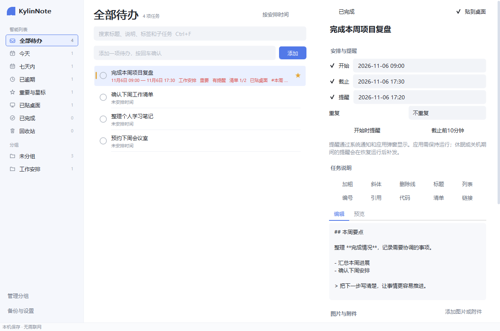

# 麒麟清单（KylinList）

[](https://github.com/hualiyexi/kylinnote/actions/workflows/build.yml)

面向离线办公环境的个人任务与清单软件。统一管理任务、子任务、时间与多提醒，支持将需要关注的任务贴到桌面。桌面便签只是任务的展示方式，不是独立的数据对象。采用原生 Qt Widgets，不依赖浏览器、账号或云服务。

主要目标是 **银河麒麟 V10 SP1 / 飞腾 FT-2000 / ARM64**，Windows x64 用于开发预览。Linux 固定在 **Ubuntu 20.04** 中构建，两端均使用 **Qt 5.12.8**。1.0.0 实机试装反馈显示，旧版银河麒麟上的系统 Qt 版无法启动，请选自带 Qt 的安装包。历史虚拟机记录、构建基线及实机验证范围见[兼容性基线](docs/kylin-development-workflow.md)。

## 可以做什么

- **任务面板**：快速记录任务与笔记；按清单、时间、创建时间、优先级或无分组展示。五种分组与范围筛选正交，不提供独立的“排序／顺序”UI；全局搜索入口暂不开放。
- **智能视图**：全部待办、今天、明天、最近7天、收集箱、已完成、已放弃和回收站；逾期任务保留在列表分组中并支持顺延。
- **清单组织**：单层文件夹、可平铺清单与唯一收集箱，任务和笔记共用组织；支持四档优先级、置顶与真正的父子任务。已完成、已放弃及回收站也可按五种模式分组，历史视角只读禁拖。
- **时间安排**：默认使用 `Asia/Shanghai` 时区，日期入口支持单日、明确时刻、全天或带时刻的时间段，以及公历／农历和自选日期的自定义重复规则；时间、提醒与重复在浮层中编辑草稿，确认后才保存。
- **本地提醒**：任务和笔记均可保存多个一次性提醒，包括相对日期、时间段结束或自定义绝对时刻；系统托盘通知和应用弹窗可打开实体或延迟 10 分钟、30 分钟、1 小时，任务可标记完成，笔记提醒不提供完成按钮。没有持续提醒或重复投递机制。
- **桌面便签**：六色小圆角纸面，直接编辑标题与正文，和任务详情逐字双向更新；小型操作按钮仅悬浮显示，左下日期可直接打开日期选择器。拖动时可吸附屏幕边缘或其他便签，并支持横向／纵向排布、八向缩放、普通／置顶／桌面底层。关闭便签只取消当前设备的桌面展示。
- **任务小部件**可从托盘右键或「设置 → 桌面小部件」添加。在桌面切换清单、快速添加任务、勾选完成或查看详情，也可通过右上角菜单设置分组、日期显示和外观。
- **Markdown 正文**：格式操作使用 SVG 图标，收在底栏 A 展开的工具岛与选中文字工具条；正文持续以富文本编辑，输入 `# ` 即刻成为标题，完成行内格式后立即呈现，光标往返不会退回源码或改变排版。检查框点击直接切换完成状态并支持撤销，保留原光标、选区与滚动位置；正文仍保存为 Markdown。支持标题、加粗、高亮、列表、斜体、下划线、删除线与链接等；复用原生 Qt 和内置 MD4C，运行时不用联网。
- **图片与附件**：选择或向详情及其子控件拖入本地单／多文件，单个不超过 2 MiB。文件复制到受管目录，保留原文件。点击附件用系统默认程序打开，图片也可从附件菜单预览。
- **数据维护**：本地 SQLite、自动保存、回收站恢复、`.klb` 全量备份导出与覆盖恢复（含附件，**不是合并导入**）。恢复会替换本机全部任务、笔记与清单，操作前应先导出；保存失败保留当前编辑内容并明确提示。
- **开机自启**：设置 →「通用」中的「开机自启动」正式安装版默认开启，可关闭且不会被自动复活；登录后在后台恢复上次打开的桌面便签与任务小部件。

## 界面预览

真实 Windows 桌面渲染，不是网页原型：



## 下载与安装

每次 push 到 `main` 会触发 [GitHub Actions](https://github.com/hualiyexi/kylinnote/actions)，分别产出 Linux ARM64、Linux amd64 和 Windows x64 的安装包；`v*` 标签会在三个构建目标全部验证成功后附到 [Releases](https://github.com/hualiyexi/kylinnote/releases)。GitHub 仓库的外部名称尚未更改，以上地址继续使用原仓库路径。

| 平台 | 安装包 | 使用方式 |
|---|---|---|
| 银河麒麟 ARM64（推荐） | `kylinlist_<版本>_arm64_bundle.deb` | 自带 Qt 5.12.8 及 SQLite、xcb、SVG 插件，可用 `sudo apt install ./文件名.deb`。系统依赖齐全时可离线用 `sudo dpkg -i 文件名.deb` |
| 系统 Qt 兼容的 ARM64 设备 | `kylinlist_<版本>_arm64.deb` | 使用系统 Qt 运行库及插件，`sudo apt install ./文件名.deb` |
| 麒麟 x86_64 / x86 虚拟机 | `kylinlist_<版本>_amd64_bundle.deb` | 自带 Qt 及插件，`sudo apt install ./文件名.deb` |
| 系统 Qt 兼容的 x86_64 设备 | `kylinlist_<版本>_amd64.deb` | 使用系统 Qt，`sudo apt install ./文件名.deb` |
| Windows x64 | `KylinList-<版本>-Windows-x64-Setup.exe` | 当前用户安装到 `%LOCALAPPDATA%\Programs\KylinList`，无需目标机器另装 Qt |
| Windows x64 | `KylinList-<版本>-Windows-x64.zip` | 解压到可写目录运行 `kylinlist.exe` |

Linux CI 分别在原生 ARM64、amd64 runner 的 Ubuntu 20.04 容器中构建，每个架构检查普通包与 bundle；Windows CI 生成安装版和便携版。Artifacts 名称分别为 `kylinlist-linux-arm64`、`kylinlist-linux-amd64`、`kylinlist-windows-x64`。固定构建基线后，日常开发沿用现有测试即可。飞腾真机的启动、中文输入和托盘等表现由用户实际试用确认；自带 Qt 的 bundle 仍需系统已有的 glibc、驱动和基础图形库。

完整构建、打包和复现方式见 [构建文档](docs/building.md)。

## 日常使用

1. 打开面板，在上方输入任务标题并按回车。
2. 在右侧编辑标题与正文、设置日期和提醒，底栏选择所属清单；子任务等低频操作收在更多菜单。更改会自动保存，也可按 `Ctrl+S`。
3. 通过任务菜单的“贴到桌面”打开便签，直接编辑标题和正文；两处实时联动。左下日期设置时间与提醒，右下更多可新建、完成、排列或删除，悬浮时才显示操作按钮。
4. 关闭便签会保留任务；“移到回收站”才删除任务，回收站里可恢复或永久删除。
5. 关闭面板后程序留在托盘运行。退出程序、关机期间无法弹提醒；再次运行或休眠恢复后补发尚未通知的到期提醒。

提醒按约 15 秒的轮询周期检查；系统的勿扰设置可能屏蔽系统通知，因此同时提供应用弹窗。不承诺关机唤醒、邮件、手机推送或后台系统服务。当前没有登录或服务器同步功能；未来账号同步只会是可选项。

| 快捷键 | 作用 |
|---|---|
| `Ctrl+N` | 在面板快速添加任务 |
| `Ctrl+F` | 搜索任务 |
| `Ctrl+S` | 保存正在编辑的任务 |
| `Ctrl+B` / `Ctrl+I` | 在说明编辑区插入加粗 / 斜体 |
| `Ctrl+Shift+X` | 在说明编辑区插入删除线 |
| `Space` | 在任务列表切换所选任务的完成状态 |

快捷键限于应用窗口，不抢占其他软件的全局 `Ctrl+N` / `Ctrl+D`。

## 开发与维护

```text
src/
  domain/       任务、清单、重复规则、多提醒和序列化约定
  db/           本地 schema、事务仓储和数据完整性
  app/          TaskStore 业务操作、ReminderScheduler 提醒调度、窗口装配
  ui/           任务面板、模型/委托、详情编辑器、Markdown、桌面便签
  platform/     登录自启、单实例唤醒、屏幕适配和可选平台能力
third_party/    固定版本的 MD4C 及许可证
packaging/      Linux / Windows 打包与隔离运行验证
tests/          核心与原生界面集成测试
```

没有把 SQL 放进窗口，也没有让每个便签维护一份独立任务。详情编辑器只回写实际编辑的字段；窗口位置、提醒去重和业务状态通过同一个 TaskStore 进入仓储。多条相关操作在 SQLite 事务中一同提交。

推送到 `main`、创建 PR 或手动运行工作流，可执行 Linux ARM64、Linux amd64 和 Windows x64 的 CI。原生 UI 测试由 QtTest 驱动，不使用 WebView；今后若加入网页界面，其测试应继续遵循 Chromium 78 兼容基线。

进一步说明：

- [数据模型、备份与未来同步边界](docs/data-model.md)
- [全面合成演示数据的生成、校验与安全重建](docs/testing-demo-data.md)
- [界面设计约定](docs/ui-design.md)
- [第三方来源与许可](THIRD_PARTY.md)

## 数据位置与更名边界

新数据库为 `kylinlist.db`。Linux 默认路径是 `~/.local/share/kylinlist/kylinlist.db`；Windows 使用 Qt 的本地应用数据目录，可从第一列“同步与数据 → 打开数据位置”进入。卸载程序保留个人任务。

**更名前旧产品与当前 KylinList 是两条兼容边界**：更名前 KylinNote 的旧数据、旧设置和旧备份不迁移；程序不读取也不删除旧 `notes.db`，旧目录仍由用户自行管理，旧 `.knb`、旧 `.json` 及其他旧产品格式不导入。

当前 KylinList 使用 **schema v10、`.klb` 备份元数据 v6**。开发阶段不做旧数据库迁移或旧备份转换：完全空库直接建立 v10；旧 v5–v9、错误标识和未来版本只读拒绝，不静默删除或重置。开发预览可换用新的空数据目录直接重建。备份只导入当前 v6，完整保存时间段、重复规则／进度与正常提醒规则；旧版本在修改本机库或附件前拒绝。具体范围见[数据模型](docs/data-model.md)。

开发时可用 `kylinlist --data-dir <独立目录>` 隔离真实数据，也可设置 `KYLINLIST_DATA_DIR`；`--smoke-test` 在临时目录自检启动后退出。需要每次打开都能看到覆盖多种清单、任务、笔记、日期、提醒、附件与便签状态的数据时，使用 `tools/generate_test_data.py` 的 `--seed`、`--verify`、`--reset` 和 `--launch`；安全边界与命令见[演示数据指南](docs/testing-demo-data.md)。不要在运行时直接复制 SQLite 的单个主文件作为备份，应使用“导出备份”或先退出程序。
