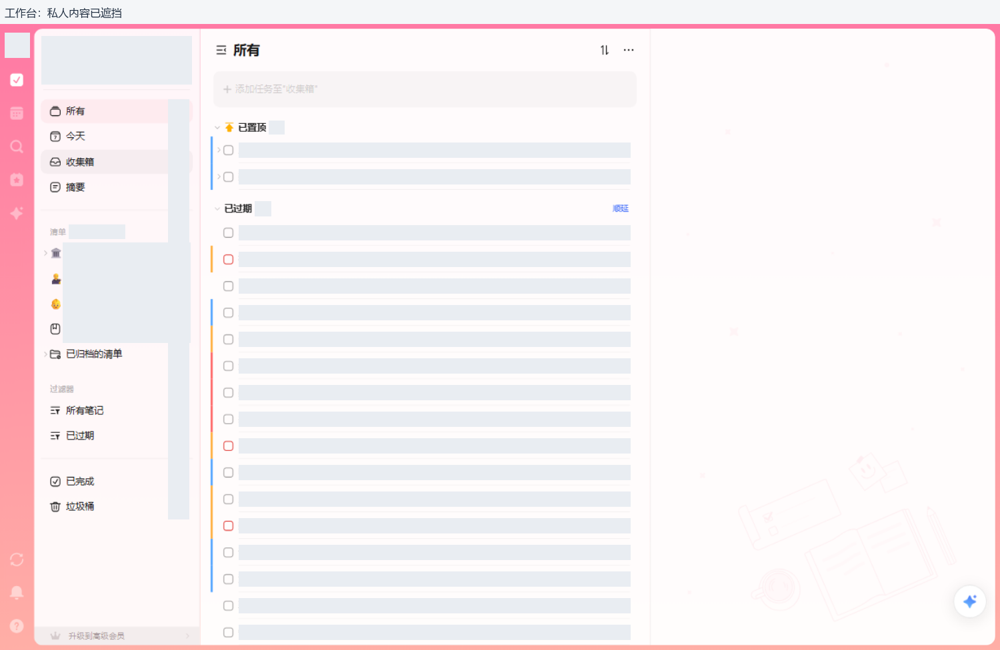
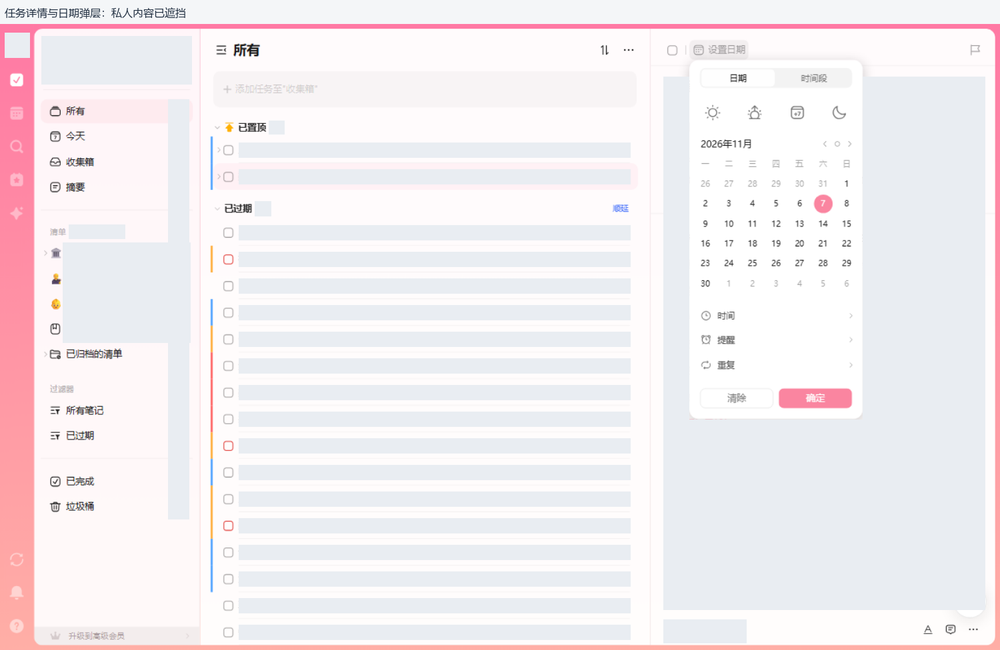

# 01｜工作台布局、视觉语言与前端结构

[返回目录](README.md) · [导航与组织](02-navigation.md) · [代码证据](code-evidence.md)

> **对象：滴答清单 Web，2026-11-07。** 本章的像素值是指定视口下的现场采样或明确的发布代码规则，不是所有主题、窗口和设备的固定规范。当前是账号选用的粉色渐变＋卡片样式，不是默认主题。

## 1. 先把界面分成三个层次

1. **全局功能层**：最左功能条，负责在任务、日历、四象限、专注、习惯、搜索、倒数、AI 等模块间切换；底部还有同步、通知、帮助一类全局入口。
2. **当前工作区层**：任务模块里再分组织导航、任务列表、任务详情。日历、四象限等模块不强制保留同样的组织侧栏。
3. **临时操作层**：右键菜单、更多菜单、日期/优先级选择器、搜索浮层和设置弹窗。它们不是固定占一栏的业务内容。



图中灰块是隐私遮挡，不是滴答原生占位样式。图片顶部的说明条由本研究另加；下文坐标均以**原始 1500×940 画面、未加说明条**为准。

## 2. 基准几何：1500×940 CSS px、DPR=1

| 区域 | 现场范围 / 尺寸 | 作用与边界 |
|---|---|---|
| 全局功能条 | x=0，宽50，高940 | 定宽、不参与横向伸缩；不是证实采用了 `position:fixed` |
| 内容卡片外框 | x=50、y=6，约1444×928 | 外部留细边，圆角14px；主题底色在外侧可见 |
| 组织侧栏 | x=51、y=7，约249×926 | 当前展开宽度；源码支持折叠和宽度控制，不是永远249 |
| 中部任务区 | x=300、y=7，约675×926 | 选中详情或空详情时保留中间工作面；看板可占用更宽空间 |
| 右侧详情区 | x≈975、y=7，约518×926 | 本次宽度；发布实现有百分比、最小宽和覆盖模式 |
| 任务区头部 | 约64px高 | 左侧收起导航与标题，右侧分组排序、更多 |
| 左栏条目 | 36px高，左右留边 | 图标/名称在左，计数或悬停更多在右，选中底圆角10px |
| 普通单行任务 | 40px高；标题文字行约21px | 完成框与标题分离；复杂行、子任务和详情正文不能套此高度 |
| 详情底部工具栏 | 48px高 | 所属清单在左，格式、评论、更多在右；不随正文一同滚走 |
| 功能条入口命中区 | 现场常见40×40，内有图标 | 不把20px SVG尺寸当成完整点击热区 |

快速添加使用编辑器，不能仅凭背景框就写成“固定40px输入框”：现场不同焦点/编辑状态有不同高度，已确认其文字行高与 CodeMirror 结构。

## 3. 按钮为什么放在这些位置

| 位置 | 已观察控件 | 布局原则的解读（不是源码原注释） |
|---|---|---|
| 功能条顶部 | 头像；模块图标 | 身份/全局设置与工作区切换放在固定锚点 |
| 侧栏上方 | 智能清单；部分阶段还有置顶组织快捷项 | 常用入口比深层文件夹更靠前；快捷区会受账号配置影响 |
| 侧栏中段 | 清单、文件夹、过滤器 | “内容属于哪里”与“筛选哪些内容”分别成区 |
| 侧栏下方 | 已完成、垃圾桶；Mini日历可配置 | 历史与恢复操作不混在常规清单里 |
| 列表头部右侧 | 分组排序、更多 | 改变当前视图，而不是改变某个任务 |
| 标题下方 | 快速添加 | 新建任务的固定入口，不要求先打开详情 |
| 任务行最左 | 展开箭头、完成框、颜色标记 | 层次、状态、归属信号比附加文字更容易扫读 |
| 任务行中/右 | 标题；清单、日期及附件/子项等图标 | 标题优先，元信息压缩并可截断；不是把所有属性排成表单 |
| 详情顶部 | 完成框、日期、优先级 | 高频属性随任务选择可立即访问 |
| 详情中部 | 标题、正文、外部关联块、子任务 | 内容阅读与编辑优先，长内容有自己的滚动区域 |
| 详情底部 | 清单、格式、评论、更多 | 次级属性与扩展命令固定收纳，避免挤满顶部 |

右键与底部更多的命令不同，详见[菜单专项](04-menus.md)，不能把“所有动作”简单复制到每个按钮上。

## 4. 看起来是什么风格

### 4.1 基底轻、内容密度高，强调色只做关键提示

- 大面积近白背景、很轻的分隔线，正文以深灰为主；大卡片与内部留白建立区隔。
- 多数按钮以图标、悬停底色或淡选中底表达，而不是持续显示厚边框。
- 相同形状和间距反复出现：小图标、圆角条目、同高任务行、头部工具组。
- 强色用于主题、日期/状态、优先级和四象限语义，而不是给每个面板涂一种大饱和底色。
- 文本过长时截断，详细信息在详情或弹层内展开。截图中的省略不等于数据被截断保存。

### 4.2 本次可复核的颜色与字体

| 项目 | 现场或代码证据 | 不应怎样外推 |
|---|---|---|
| 主文字 | `rgb(25,25,25)`，即 `#191919` | 不等于所有次级字也用此色 |
| 通用品牌强调 | `rgb(71,114,250)`，即 `#4772FA` | 粉色主题的所有交互色不一定仍是蓝色 |
| 过期日期 | `rgb(224,49,49)`，即 `#E03131` | 不把所有红色都解释成删除或报错 |
| 当前功能条渐变 | `#FF79A4 → #FFAFA6` | 这是当前主题，不能当默认品牌色 |
| 当前侧栏选中底 | `rgba(250,133,160,0.1)` | 其他主题、暗色态会变 |
| 四象限标题 | `#FF5F68 / #FFB000 / #4772FA / #0CCE9C` | 只确认这些标题，不把颜色直接等同完整分类算法 |
| 正文字体 | `"Color Emoji", system-ui, -apple-system, BlinkMacSystemFont, "Segoe UI", Roboto, Helvetica, …` | 不能说全站强制某个独立中文字体 |
| 主体基准字号 | 14px | 标题、辅助文字、菜单项等另有规则 |

**圆角也分层**：内容卡片14px、普通菜单外框常见12px、选中导航10px、悬停菜单项8px。并不是全站统一套一个圆角。一般菜单项CSS为13px/34px行高；详情更多菜单的根节点现场继承14px，根字号不等于每个子项的最终字号。

## 5. 前端本身怎样组织

下面是**从现场DOM提炼的组件边界示意**，省略无关包装与所有私人内容，不是逐字复制完整HTML：

```text
#container-main / Flex、满高、裁切溢出
├─ #left-view / 全局功能条
└─ .cardContainer.cardRadius / 当前工作面
   ├─ #leftListView、.lists / 组织侧栏
   ├─ .tasklist.tasks.g-center / 任务列表工作区
   │  ├─ header.tl-bar / 标题与视图操作
   │  ├─ CodeMirror / 快速添加
   │  └─ 分组、任务行与列表滚动区域
   └─ #right-view / 详情区域
      ├─ #task-detail-inner / 顶部与内容
      ├─ #tasktitle / 标题编辑器
      ├─ #taskcontent / 正文组件
      ├─ #sub-task-list / 子任务容器
      └─ footer.td-footer / 底部工具栏
```

实际发布代码证实的重点，而不是由截图猜测：

1. **React组件与Webpack分块**：发布包中有 React/ReactDOM 17.0.2 实现声明及入口调用链；未读取隐藏运行时状态，也未核查完整依赖树。
2. **Tailwind产物＋局部类映射**：CSS有v3.2.7横幅与真实utility规则；JS类名导出、组件引用、CSS声明可以闭环对应。并非只因类名像Tailwind就下结论。
3. **Flex主布局**：定宽导航、受控侧栏、弹性列表和受约束详情共同工作，不是简单把宽度分成三等份。
4. **编辑器有边界**：快速添加/标题等位置有CodeMirror结构与初始化；正文组件另接收ProseMirror view引用、附件和只读参数。不能概括为“所有输入都是一个textarea”或“全部都是CodeMirror”。
5. **上下文菜单是应用组件**：任务行代码阻止系统默认菜单、存储事件页坐标并打开菜单；这不是浏览器原生右键菜单换皮。
6. **交互包含时序**：搜索输入有独立onChange/onKeyDown；模块开关有入口过滤及加载通知；子菜单有悬停与溢出调整。复制静态HTML不能获得这些行为。

代码定位见[发布代码证据第3–9节](code-evidence.md)及[业务组件证据T1–T5、S1–S5](component-code-evidence.md)。未取得原始仓库源码；明确检查的3份source map均404，详见[源码映射结果](source-map-evidence.md)。

## 6. 响应式不是“把三栏一起缩小”

以下来自代码，**不是已在所有尺寸上运行验证**：

- 列表侧栏能折叠到0；窄屏有覆盖定位和按视口90%限宽的分支。
- 详情默认类有36%，另有最小320px与按视图施加内联宽度的分支。
- 500–952px详情有400px覆盖规则；≤499px详情可占满宽度；953px起有桌面最小宽规则。
- 设置弹窗常态居中限高，≤632px切换到贴边、取消圆角/transform的布局。
- 四象限CSS明确两列两行，列最小325px、行最小185px；不能仅因此声称任意小窗都会自动变单列。

这组行为说明：后续改造应定义“导航、列表、详情谁优先保留”，而不是让内容被挤到不可用。

## 7. 截图与代码必须互相校验



本次采集遇到了加载空态、截图旧帧、clip拼接等工具现象。因此：

- 初始“无数据”不直接当成账号实际为空，要等稳定内容再记录。
- 截图里的布局与DOM不一致时，不把该图标成已验证的新视图。
- 最终配图用完整截图离线裁切；异常采样不交付。
- 一般菜单CSS的300px/288px上限有特例，现场详情更多UL可达494px，不用单条规则覆盖全局。

## 8. 借鉴时保留哪些，不应盲从哪些

**值得借鉴**：稳定锚点、对象/视图分层、高频操作靠近对象、低频命令分组、列表与详情共享对象、颜色有明确语义。

**应独立验证**：无可访问名称的图标、长菜单、悬停才能发现的入口、极窄窗口、中文输入和键盘焦点。现场树里确有无名称按钮，不应因为产品成熟就把这些细节当成理想范式。

不建议照搬商标、专有插画、账号/付费/AI入口或整套发布bundle。KylinNote应借鉴交互结构，保留其离线Qt与桌面便签定位；具体取舍见[改造建议](07-kylinnote-design-brief.md)。
