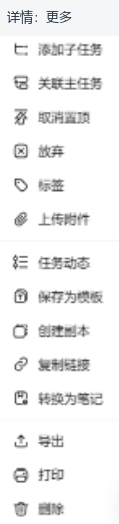

# 04｜右键、更多菜单与属性选择器专项

[返回目录](README.md) · [任务交互](03-task-interactions.md) · [覆盖账本](08-evidence-and-coverage.md)

> **不能用一张“任务右键图”代表所有菜单。** 下面记录的是不同对象、状态和入口的真实输出。包括右键、更多、悬停子菜单及属性选择器；26个已观察入口不等于26套右键菜单，更不等于覆盖所有平台/账号特例。

## 1. 方法和安全边界

早期智能清单/收集箱取得原生右键采样。后续浏览器locator右键不稳定、坐标接口不支持右键，部分位置使用已识别DOM节点的 `contextmenu` 事件展开应用菜单；更多按钮、选择器和悬停主要使用可见节点/原生指针操作。

这足以核对**应用生成了什么菜单**，但不等于通过原生鼠标、键盘、触摸、屏幕阅读器兼容测试。没有执行菜单中的完成、放弃、移动、删除、复制、上传、导出、打印或计时等业务命令。只打开子层后取消；不点击目标清单、标签或属性新值。

## 2. 位置矩阵

“√”表示本轮取得了该入口的内容；“未得样本”不表示产品一定没有该能力。

| 编号 | 位置 / 前置状态 | 触发类型 | 本轮结果 |
|---|---|---|---|
| R01 | 智能清单“所有” | 右键 | √ 隐藏 |
| R02 | 收集箱 | 右键 | √ 编辑、显示策略 |
| R03 | 已置顶的文件夹 | 上下文事件 | √ 添加清单、编辑、取消置顶、解散 |
| R04 | 普通清单 | 上下文事件 | √ 编辑、置顶、复制、共享、归档、删除 |
| R05 | 过滤器 | 上下文事件 | √ 编辑、置顶、复制、删除 |
| R06 | 已置顶、未完成、无日期主任务；专注未启用阶段 | 上下文事件 | √ 日期/优先级条＋任务命令，取消置顶 |
| R07 | 未置顶、有日期、未完成任务；专注临时启用阶段 | 上下文事件 | √ 日期图标更多、置顶、开始专注等 |
| R08 | 普通笔记；专注临时启用阶段 | 上下文事件 | √ 无优先级/添加子任务项，提供转换为任务 |
| R09 | 已完成且仍置顶的任务 | 上下文事件 | √ 修改完成时间；与未完成菜单不同 |
| R10 | 垃圾桶中的现存删除项 | 上下文事件 | √ 恢复、永久删除 |
| R11 | 任务详情底部 `···` | 更多按钮 | √ 上传附件、任务动态、模板、导出/打印等 |
| R12 | 列表/看板工作区右上 `···` | 更多按钮 | √ 视图、完成显示、详细显示、显示设置、打印 |
| R13 | 时间线右上 `···` | 更多按钮 | √ 视图、完成显示、显示设置、安排任务 |
| R14 | 任务区分组排序按钮 | 选择器 | √ 分组、排序、顺序三行；未选择新值 |
| R15 | 头像 | 全局菜单 | √ 设置、统计、高级会员、退出登录 |
| R16 | 已选习惯详情右上 `···` | 更多按钮 | √ 编辑、开始专注、打卡样式、归档、删除 |
| R17 | 倒数模块预置节日卡片 | 上下文事件 | √ 编辑、样式、备注、归档、删除 |
| R18 | 倒数模块自定义纪念项 | 上下文事件 | √ 同一组五项；不据此覆盖所有纪念类型 |
| R19 | 日历头部视图 | 选择器 | √ 日、周、月、年、日程、多日、多周 |
| R20 | 时间线时间尺度 | 选择器 | √ 日、周、月 |
| R21 | 任务详情顶部优先级旗标 | 选择器 | √ 高、中、低、无优先级 |
| R22 | 日期弹层“提醒” | 属性弹层 | √ 提醒偏移、自定义、持续提醒、取消/确定 |
| R23 | 日期弹层“重复” | 属性弹层 | √ 常见周期、工作日/节假日、记忆法、自定义 |
| R24 | 任务菜单“标签” | 选择器 | √ 标签列表＋取消/确定，未勾选 |
| R25 | 任务菜单“移动到” | 悬停子菜单 | √ 搜索框＋清单/文件夹层次，未选择目的地 |
| R26 | 两条同清单、均置顶的未完成任务多选 | 上下文事件＋批量面板 | √ 复制文本、合并等批量命令；未执行 |
| R27 | 本轮习惯行标题命中点 | 上下文事件 | 未得自定义菜单样本；详情更多已在R16取得 |

菜单里的“置顶/取消置顶”“显示/隐藏”通常是**可执行动作**，不是简单的当前状态标签。不要只凭看到一项“隐藏”就断言对象已经隐藏。

## 3. 导航对象：同在侧栏，操作层级不同

| 对象 | 菜单原文及顺序 | 设计含义 |
|---|---|---|
| 所有 | 隐藏 | 系统聚合入口，不提供删除其内容的动作 |
| 收集箱 | 编辑 → 有内容时显示 → 隐藏 | 系统入口与显示策略；不套普通清单菜单 |
| 文件夹（本例已置顶） | 添加清单 → 编辑 → 取消置顶 → 解散 | 对容器操作，不把“解散”改写成“删除里面全部任务” |
| 普通清单 | 编辑 → 置顶 → 复制 → 共享 → 归档 → 删除 | 对完整清单及生命周期操作；命令后果本轮未执行验证 |
| 过滤器 | 编辑 → 置顶 → 复制 → 删除 | 操作筛选定义，不提供共享/归档项 |


图是纯控件局部，不拿裁图尺寸反推菜单完整外框或阴影尺寸。文件夹/清单的私人名称没有带入本手册。

## 4. 未完成任务：顶部是属性快捷条，下面才是命令

R07现场原顺序：

```text
日期：6个快捷图标
优先级：高 / 中 / 低 / 无，4个旗标
────────
添加子任务
关联主任务
置顶
放弃
移动到 ▸
标签
────────
开始专注 ▸                 ← 模块已启用阶段才取得
────────
创建副本
复制链接
转换为笔记
删除
```


- R06主任务本例显示“取消置顶”；R07显示“置顶”。
- 无日期与有日期任务的日期图标条数量不同。本次识别到的SVG为 `quick-today`、`tomorrow-list`、`quick-nextweek`、`quick-nextperiod`、`date-unselected`、`quick-clear`。
- `quick-nextperiod`未核对tooltip，不猜成“下次重复”或“下个月”的确定命令。
- 优先级SVG为 `priority-3/2/1/0`；顶部旗标选择器另取得“高优先级/中优先级/低优先级/无优先级”原文。
- 嵌套图标条里的 `...` 在某些状态是disabled溢出项，不是所有省略号都能继续点击。
- R07里出现“开始专注”不能单独归因会员；本轮还明确临时启用了专注模块，两个条件应分开。

## 5. 笔记、已完成与垃圾桶：删减与增加都有依据

| 状态 | 本轮菜单原顺序 | 和未完成任务的主要差异 |
|---|---|---|
| 普通笔记 R08 | 日期；置顶；移动到；标签；开始专注；创建副本；复制链接；转换为任务；删除 | 没有本例任务菜单中的优先级、添加子任务、关联主任务、放弃；转换方向相反 |
| 已完成且置顶任务 R09 | 日期；优先级；关联主任务；取消置顶；放弃；移动到；标签；开始专注；复制链接；修改完成时间；删除 | 增加修改完成时间；本例没有添加子任务、创建副本、转换为笔记 |
| 垃圾桶删除项 R10 | 恢复；永久删除 | 没有普通任务的属性编辑、移动、复制等长菜单 |

“完成后如何撤销”不能由上述菜单缺项推成“不支持”：完成框是另一个入口，本轮没有执行状态修改验证。也没有为采样删除任务；使用的是垃圾桶里原有项目。

已完成页的“所有完成”下拉本轮只有**我完成的 / 所有完成**，是完成者范围，不是已完成/已放弃状态切换。

### 多选不是单项菜单重复两次

R26在两条同清单、均置顶的未完成任务中实际显示“已选择 2 项”。通过模拟带ctrlKey的行点击进入，只验证生成的选择态，不宣称原生Ctrl/Shift跨平台行为已验收。

- 右侧批量面板：设置日期、优先级、所属清单、标签；完成、取消置顶、放弃、关联主任务、合并、创建副本、转换为笔记、复制文本、删除。
- 多选右键：日期、优先级、取消置顶、完成、放弃、移动到、标签、关联主任务、创建副本、复制文本、合并、转换为笔记、删除。
- 列表分组还出现“全选”。未点击全选、合并、完成等命令；已用面板“取消”退出。
- 本例出现的是“复制文本”，不能写成单项菜单的“复制链接”。混合任务/笔记、完成/未完成或跨清单组合仍未验证。


## 6. 详情底部更多：不是任务右键的副本

R11原顺序：添加子任务、关联主任务、取消置顶、放弃、标签、上传附件；任务动态、保存为模板、创建副本、复制链接、转换为笔记、导出、打印、删除。



这个裁图为避开右下悬浮按钮，只保留菜单左侧图标和文字，**不能用其宽度当实际菜单宽度**。现场UL测得约162×494、可纵向滚动。

**设计解读**：日期/优先级已在顶部；所属清单已在底部左侧，因此更多里不必重复完全相同的快捷条。附件、动态、模板、导出等适合收在详情范围。这个解释是基于位置关系的归纳，不是取得了设计团队的内部决策记录。

导出hover未取得格式子菜单，未点导出以避免直接生成文件。导出格式、打印预览、文件上传对话框和任务动态深层内容都不冒充已验证。

## 7. 工作区级菜单：管理“怎么看”，不管理单个任务

| 入口 | 原文 / 结构 |
|---|---|
| 列表/看板更多 | 视图图标条（列表、看板、时间线、溢出）；隐藏已完成；显示详细；显示设置；打印 |
| 时间线更多 | 视图图标条；隐藏已完成；显示设置；安排任务 |
| 分组排序 | 分组〔现场时间〕；排序〔现场时间〕；顺序〔现场从旧到新〕 |
| 显示设置 | 日期显示；窄窗详情侧边栏/弹窗；视图跨设备同步 |


没有修改分组、排序、显示策略或跨设备同步。为观察看板/时间线切换了视图，之后已回到列表。

## 8. 子层和其他模块

- **移动到**：真实悬停并等待约400ms后出现搜索框与清单/文件夹层次。早期立即抓快照未出现，不能因此判定“没有子菜单”。不选择目标。
- **标签**：显示标签候选、取消/确定；只展开，不勾选或保存。
- **提醒**：当天、提前1/2/3天、提前1周、自定义；本次显示09:00及持续提醒。时间是现场样本，非跨账号固定默认。
- **重复**：每天、每周/每月/每年（附当前日期说明）、工作日、节假日、艾宾浩斯记忆法、自定义；未进入自定义深层配置。
- **习惯详情更多**：编辑、开始专注、打卡样式、归档、删除。打卡圆点与更多入口是不同命中区。
- **倒数卡片右键**：本次预置节日与自定义纪念项同为编辑、样式、备注、归档、删除；不代表所有卡片类型和归档状态都一样。
- **日历视图菜单**：日/周/月/年/日程、多日、多周；后两项附当前数量，多日和日、 多周和月会复用路由，不能只按URL数量统计视图。

## 9. 菜单组件代码怎样支撑这些现象

1. [T2](component-code-evidence.md)确认任务行onContextMenu链会阻止默认菜单与冒泡、保存pageX/pageY、设置打开状态；门控布尔的完整语义未确认。
2. [R3/R7菜单证据](code-evidence.md#6-菜单布局层级悬停禁用与子菜单)有点击触发、隐藏销毁、溢出调整、hover子菜单与偏移配置；它证明组件实现存在，不证明每个菜单都走相同分支。
3. 侧栏菜单出现 `dropdown-menu-menu-item`，任务右键项出现 `rc-menu-item`。不把命名相似等同完全相同组件或npm版本。
4. 一般CSS含菜单外框12px圆角、item 34px高、hover灰底/8px圆角、disabled颜色及not-allowed；disabled视觉不等于已验证全部事件保护。
5. 一般CSS的300px外框/288px滚动区上限有特例；任务右键长菜单与详情494px样本说明不能套一个全局常数。

## 10. 后续改造的直接约束

- 对象类型、完成/删除状态、置顶、模块启用等共同决定命令集合；不要硬编码一张“大菜单”。
- 同一业务命令应共享执行入口，但**呈现集合可以不同**：右键、行内更多、详情更多和批量面板不必全部一样。
- 属性快捷条与破坏性命令分组；恢复/永久删除仅放在回收站语境。
- hover子菜单要有退出与溢出策略，也应有可访问的点击/键盘路径；本轮未验收后两者。
- 复制、转类型、改完成时间、上传与永久删除均需后续业务契约和失败测试，不能只凭菜单外观宣称已实现。
