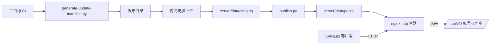

# 内网软件更新

更新日期：2026-11-13。本文描述麒麟清单的可信局域网更新分发：Docker 发布服务、更新清单协议、客户端检查与安装流程，以及发布方式。

## 目标与边界

- 更新服务器部署在用户自己的局域网内网宿主机上，Docker Compose 管理；**纯 HTTP，无 TLS、无证书、无发布签名**。SHA-256 只用于下载完整性校验，不承担来源认证；网络边界由内网可信性保证，服务不得暴露公网。
- 客户端始终本地优先：断网、服务器维护或检查失败不影响本地任务与清单的任何功能。
- 未来的账号与清单同步是**独立**的业务接口（`/api/v1/`），不复用更新协议；更新服务不依赖登录。客户端中 `UpdateService` 与未来的同步服务各自维护状态。
- 首版不做：长连接推送、后台强制安装、差分更新、管理后台、跨安装形式（系统 Qt ↔ bundle、安装版 ↔ 便携版）的自动切换。

## 组成



- `server/`：Compose 定义、nginx 配置与发布工具，部署与命令见 [server/README.md](../server/README.md)。
- `packaging/generate-update-manifest.py`：CI 在三目标构建通过后生成发布目录（含 manifest 与安装包）。
- 客户端：`src/app/updates/`（身份、协议、服务）、`src/platform/UpdateInstaller.cpp`（安装交接）、`src/ui/UpdateDialog.cpp`（界面）、`KylinListApp` 协调保存与安装。

## 更新清单协议 v1

入口固定为 `<基础地址>/updates/v1/stable/manifest.json`；安装包地址为 `<基础地址>/updates/` + `artifacts[].path`。

```json
{
  "schemaVersion": 1,
  "channel": "stable",
  "version": "1.2.0",
  "publishedAt": "2026-11-13T08:00:00Z",
  "notes": "更新说明",
  "artifacts": [
    {"platform": "linux", "arch": "arm64", "variant": "system-qt",
     "packageVersion": "1.2.0",
     "path": "files/1.2.0/linux-arm64-system-qt/kylinlist_1.2.0_arm64.deb",
     "size": 591548, "sha256": "<64位小写hex>"}
  ]
}
```

规则：

- `platform` ∈ linux/windows；`arch` ∈ arm64/amd64；`variant`：linux 为 `system-qt`/`bundled-qt`，windows 为 `setup`/`portable`。`(platform, arch, variant)` 不得重复。
- `path` 形如 `files/<版本>/<platform>-<arch>-<variant>/<原文件名>`，禁止 `..` 与绝对路径；`packageVersion` 必须等于清单 `version`。
- 客户端只接受 `schemaVersion == 1` 且 `channel == "stable"`；未知字段忽略；任何结构错误整体拒绝，不进入安装流程。
- 服务端行为：清单 `no-cache`，安装包按版本路径 `immutable` 长缓存；同版本禁止原地替换内容，修正一律发新版本；撤回通过把 stable 指回历史归档清单实现。

## 版本与安装身份

- **CMake 项目版本是唯一版本来源**：程序内置、deb、Inno Setup、安装身份与发布清单全部取同一值；正式版本只接受三段 `X.Y.Z`（无前导零），按数字比较（`1.9.0 < 1.10.0`）。`v*` 标签必须严格等于 `v<项目版本>`，CI 校验。
- 打包阶段把 `install-info.json` 写入安装：Linux 为 `/usr/share/kylinlist/install-info.json`（普通包与 bundle 同路径、不同 variant），Windows 放在程序旁（ZIP 为 `portable`，安装器写入 `setup`）。客户端读取时核对产品、平台、架构、版本与当前构建一致；缺失或不一致则禁用自动安装。
- 它与数据库中的 `installation_id`（数据 UUID）无关。

## 客户端行为

- 检查时机：启动后约 10 秒后台首查、运行期间每 6 小时复查、「备份与设置 ▸ 检查更新」手动触发。服务器地址在「备份与设置 ▸ 更新服务器」配置，留空即停用。
- 自动检查安静失败；发现新版通过面板提示或托盘信息级通知提醒（同一版本每天至多一次），不自动下载。下载与安装都由用户确认。
- 下载为流式写入数据目录 `updates/cache/`，边下边算 SHA-256；大小或哈希不符即丢弃。清单请求默认 10 秒超时，下载连续 30 秒无进展则停止。
- 「安装并退出」的准入顺序：未提交草稿检查（快速添加框、检查项新行）→ 复用 `prepareForExit()` 保存准入（详情页、便签、编辑会话）→ 生成 `.klb` 内容备份到 `updates/backups/`（保留最近 3 份）→ 再次校验安装包 → 写入待安装记录 → 交给系统安装器（Linux 用默认 deb 图形安装器打开本地文件；Windows 启动 Inno Setup 或打开 ZIP 所在目录）→ 退出应用。
- **「已交给安装器」不等于安装成功**：下次启动按实际版本确认——达到目标版本则提示成功并清理缓存；仍是旧版本则提示上次未完成；已被更高版本取代则清理记录。不做自动降级或自动恢复。
- `.klb` 备份覆盖任务、笔记与附件，不含桌面布局与全部本机设置；因此它是“更新前内容备份”，不是完整回滚方案。
- 安装失败或用户取消授权时，原版本与原数据继续可用；下载的安装包保留供重试。

### 测试钩子（仅测试/开发用）

| 环境变量 | 作用 |
|---|---|
| `KYLINLIST_UPDATE_INSTALL_INFO_PATH` | 指定 install-info.json 路径，供开发构建注入测试身份 |
| `KYLINLIST_UPDATE_FAKE_INSTALLER` | 指定脚本代替系统安装器执行交接（脚本以安装包路径为唯一参数） |
| `KYLINLIST_DATA_DIR` | 隔离数据目录（含 updates/cache、updates/backups） |

## 发布流程

1. CI（普通推送与 `v*` 标签）在 Windows x64、Linux ARM64、Linux amd64 构建通过后，运行生成器产出完整发布目录并上传为 `kylinlist-update-bundle` 产物；标签发布同时校验 tag 与版本一致并把该归档附到 GitHub Release。
2. 从能访问内网的电脑取到发布目录，放到服务器 `server/data/staging/`。
3. 在服务器上执行 `docker compose run --rm publisher validate <release目录>` 校验，再 `publish` 发布。发布是事务性的：先安装文件（同版本同哈希幂等、不同哈希拒绝），最后原子替换 stable 清单并归档旧清单。
4. 回退用 `publisher rollback [--to <版本>]`；它只影响尚未更新的客户端，已装新版者以更高版本继续。

日常发布不经过 GitHub 之外的外部服务；服务器无需访问公网（镜像可离线导入，见 server/README.md）。

## 已经验证到什么程度

2026-11-13 在功能分支上手动派发 CI（[运行 43470023611](https://github.com/hualiyexi/kylinnote/actions/runs/43470023611)）：Windows x64、Linux ARM64、Linux amd64 三个构建目标全部通过，`update-bundle` 作业产出完整六件套发布目录（六项产物、`partial=False`）并上传为 `kylinlist-update-bundle`；`release` 作业按预期跳过（分支推送，不是 `v*` 标签）。

本地另外验证过：

- Windows Qt 5.12.8 下 `tasks` / `ui` / `updates` 三套 CTest 通过。
- 在 Ubuntu 20.04 容器中分别构建 arm64 与 amd64 的普通包和 bundle，包内 `install-info.json` 的版本、架构、安装形式与构建参数一致。
- 用这四个真实 deb 运行生成器，再用 `server/tools/publish.py validate` 与 `publish` 发布，stable 清单与安装包可从数据目录原样取到。

尚未验证：真实银河麒麟上的图形化 deb 安装器行为（文件关联、授权窗口、覆盖安装时序），以及飞腾 ARM64 真机。这两项必须由用户在实际设备上确认，不能由上述自动化结果代替。

## 测试

- `tests/tst_updates.cpp`：版本解析与比较、清单校验各类错误、目标选择、安装身份、待安装判定、文件校验、`UpdateService` 检查/下载/取消/停滞/超时/哈希与大小不符（本地 HTTP 夹具）、基础地址前缀、假安装器交接，以及一份与生成器输出同形的完整六件套清单解析——它把生成器与客户端之间的协议契约固定下来。
- `server/tools/test_publish.py`：发布工具的事务性、幂等、拒绝规则与回退。
- `packaging/test_update_manifest_generator.py`：生成器纯函数校验；完整六件套在 CI 的 `update-bundle` 作业中验证。
- CI 保留既有三目标构建、CTest、安装启动检查；新增发布归档生成与 tag 校验。
- 覆盖安装（旧 deb → 新 deb）与升级数据保留断言由打包脚本测试与 CI 安装检查承担；真实麒麟上的图形化安装器行为（授权窗口、关联打开）在虚拟机/真机试用时确认。

### 已知风险

Windows 的 `ui` 测试在 CI 上出现过“进程异常退出、日志为空”的偶发失败，本地与随后的重跑均通过，尚未定位到具体用例。测试已在 `initTestCase` 里关闭 stdout 缓冲，以后再发生会留下崩溃前的完整进度，便于定位；不要把它当作可通过重跑忽略的常规噪声。

## 与数据兼容的关系

从本版本起软件进入可持续更新阶段：**schema 5 的结构在更新版本间保持不变**；后续任何 schema 变更都必须随版本提供迁移与失败处理，并通过“旧版数据库升级打开”的测试。安装取消不改变任何用户数据。
